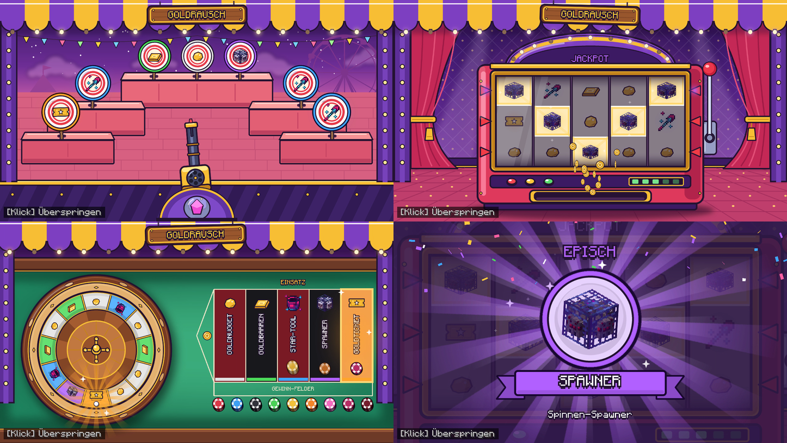
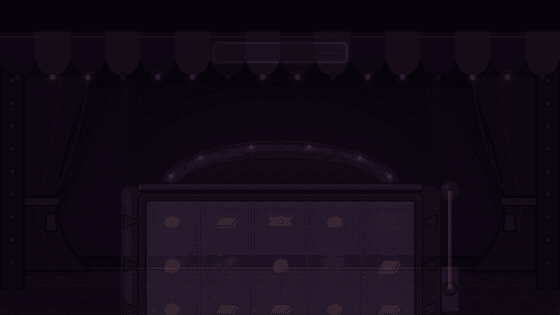
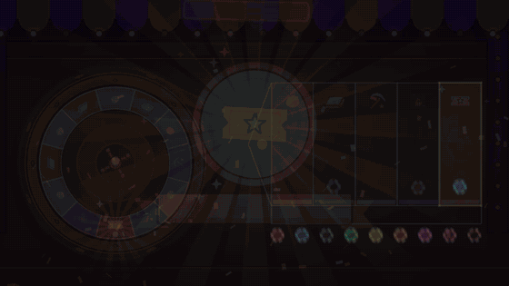

# Goldrausch Schießbude – Fabric-Mod für Minecraft 26.3

**⬇ Download:** Reiter [Actions](../../actions/workflows/build.yml) → neuester grüner Durchlauf → unten bei
**Artifacts** auf `goldrausch-schiessbude` klicken. Du bekommst eine ZIP, darin liegt die `.jar` für den `mods`-Ordner.
Jede Änderung am Code baut automatisch eine neue Version.



Bei jedem Fund spielt der Client eine Gewinn-Animation im Comic-Stil ab. Es gibt drei Buden im gleichen
Goldrausch-Look, alle etwa gleich lang (rund 6 Sekunden Spannung, dann die Enthüllung):

* **Schießstand:** Zielscheiben mit verschiedenen Gewinnen klappen auf bunten Podesten hoch. Eine goldene Pistole in
  der Mitte schießt eine Scheibe nach der anderen um, bis nur noch dein Gewinn steht. Der letzte Schuss läuft jedes
  Mal anders: Die Pistole täuscht erst deinen Gewinn an, zielt lange direkt auf den Köder, pendelt zwischen beiden hin
  und her oder hat eine Ladehemmung (*klick*), bevor sie trifft.
* **Slotmaschine (5 Walzen × 3 Reihen):** Eine Hand zieht den Hebel rechts an der Maschine runter, die fünf Walzen
  drehen sich und bleiben von links nach rechts stehen. Drei mögliche Gewinnlinien mit je einem eigenen Symbol laufen
  über die Walzen: gerade Reihen, V-Formen oder Zickzack. Am Anfang ist also noch alles offen. Danach fliegt eine
  Linie raus, vor der letzten Walze sind noch zwei im Rennen: dein Gewinn und ein Köder. Die letzte Walze kriecht aus
  und hält jedes Mal anders: direkt auf dem Gewinn, eine Reihe davor und rutscht nach, oder eine Reihe zu weit und
  rutscht zurück. Am Ende bildet immer genau ein Symbol eine Gewinnfigur über alle
  fünf Walzen (zum Beispiel ein V), jedes Symbol der Figur leuchtet golden. Danach regnet es Münzen.
* **Roulette-Tisch von oben:** Links das Rad, rechts das Wettfeld wie auf einem echten Tisch (Felder abwechselnd rot
  und schwarz, ein Feld pro Gewinn), darunter die Chip-Reihe. Eine Hand nimmt Chips und setzt Stapel auf mehrere
  Felder, dreht dann das Rad an und wirft die Kugel ein. Das Ende ist jedes Mal anders: Die Kugel fällt direkt ins
  Gewinnfach und wackelt, bleibt erst im wertvolleren Fach davor liegen (dessen Feld blinkt) und hüpft weiter, oder
  springt übers Gewinnfach hinweg und kullert zurück. Dein Feld leuchtet golden auf.

Am Ende zoomt die Kamera heran und der Gewinn wird groß enthüllt
(Seltenheit, Name und Betrag, bei Episch/Legendär mit Konfetti). Auch die Wartezeiten der Spannungspausen sind
zufällig, so weiß man nie genau, wann es so weit ist.

**Star-Tools und Spawner mit eigenem Bild:** Steht in der Server-Nachricht oder auf dem Drop-Schild z. B. „Star-Axt“,
„Kuh-Spawner“ oder „Spider Spawner“, zeigt die Enthüllung genau dieses Bild und den Namen. In den Animationen tauchen
die Varianten auch als Köder auf.

### Die Animationen in Bewegung

Jede Runde läuft anders aus. Die GIFs zeigen je ein Beispiel (aufgenommen mit Version 1.6.1).

**Schießstand**


**Slotmaschine (5 × 3, Gewinnfigur)**



**Roulette von oben**



* **Chat und obere Bildschirmmitte sind während der Animation komplett verdeckt.** Chat, Titel, Actionbar
  und Bossleiste werden zusätzlich ausgeblendet, auch wenn man mit T den Chat öffnet.
* **Warteschlange:** Kommen mehrere Funde direkt nacheinander, laufen alle der Reihe nach ab.
  Unten rechts steht, wie viele noch warten.
* Die Animation pausiert, solange ein Menü (z. B. Inventar) offen ist. So verpasst man keinen Fund.

## Sicherheit: Schutz gegen „geratet werden“

Ein „RAT“ (Trojaner in einer Mod) stiehlt z. B. den Minecraft-Account (Session-Token), Passwörter oder Dateien und
schickt sie ins Internet. **Diese Mod kann das nachweislich nicht.** Das wird bei jedem Build automatisch geprüft:

* **Kein Internet:** Die Mod benutzt keinerlei Netzwerk-Funktionen (`java.net` & Co. sind verboten).
* **Nichts an den Server:** Die Mod kann keine Pakete senden, sie empfängt nur.
* **Kein Account-Zugriff:** Kein Zugriff auf Session, Token, Profil oder Anmeldedaten.
* **Keine Dateien außer der eigenen Konfiguration:** Nur `config/schiessbude.json`, das Fund-Protokoll
  `config/schiessbude/funde.log` und (falls eingeschaltet) `config/schiessbude/pakete.log`. Der Server hat keinen Einfluss auf Pfade oder Dateinamen.
* **Kein fremder Code:** Kein Nachladen von Code, keine Reflection, keine Programme starten, keine nativen
  Bibliotheken, keine versteckten .jar-Dateien in der Mod.
* **Server-Daten werden nur angezeigt:** Text vom Server (Chat, Titel, Geld-Drop-Schilder, das Paket `schiessbude:reward`) wird gekürzt
  (max. 512 Zeichen untersucht, Paket max. 256 Byte), von Steuerzeichen befreit und nur als Text angezeigt.
  Die Warteschlange ist auf 20 Funde begrenzt, das Paket-Log auf 2 × 1 MB.

### Wie das geprüft wird
`tools/SicherheitsCheck.java` öffnet die fertige .jar und liest **jede Klasse Byte für Byte**. Erlaubt ist nur eine
feste Liste von Java-, Minecraft- und Fabric-Funktionen (Positivliste). Taucht irgendetwas anderes auf, z. B. Internet,
`getUser()`, Reflection oder eine versteckte Datei, schlägt der Build fehl und es gibt keine .jar zum Herunterladen.
Der Check wurde mit einer absichtlich präparierten Test-Mod geprüft (Token auslesen, ins Internet senden, Reflection,
Programm starten, Dateien schreiben, Paket an den Server, versteckte .jar): alles wurde erkannt.

Zusätzlich ist der Build abgesichert: alle GitHub-Aktionen sind auf feste Versionen gepinnt, die Gradle-Startdatei
wird auf Echtheit geprüft, und jede .jar bekommt eine SHA-256-Prüfsumme und einen Herkunftsnachweis von GitHub.

### So prüfst du deine .jar (wichtig, wenn du sie von jemand anderem bekommst)
Die meisten RATs stecken in **gefälschten Kopien** bekannter Mods. Lade die Mod daher nur hier herunter, oder prüfe sie:

1. **Prüfsumme vergleichen:** Im [Actions](../../actions/workflows/build.yml)-Durchlauf steht in der Zusammenfassung
   die SHA-256 der echten .jar (auch in `SHA256SUMS.txt` im Download). Deine Datei prüfen:
   * Windows (PowerShell): `Get-FileHash goldrausch-schiessbude-1.6.1.jar`
   * Linux/macOS: `sha256sum goldrausch-schiessbude-1.6.1.jar`

   Stimmt die Zahl nicht exakt überein: **nicht benutzen.**
2. **Herkunftsnachweis (mit GitHub CLI):**
   `gh attestation verify goldrausch-schiessbude-1.6.1.jar --repo Janis-exe/hugosmp_goldrauschgamba`
   bestätigt, dass die Datei von GitHub aus genau diesem Repository gebaut wurde.
3. **Inhalt prüfen (mit JDK 25):** `java tools/SicherheitsCheck.java goldrausch-schiessbude-1.6.1.jar`
4. **Selbst bauen:** Der Build ist reproduzierbar. `./gradlew build` ergibt aus diesem Code Byte für Byte dieselbe
   .jar mit derselben SHA-256 wie bei GitHub. Version 1.6.1:
   `c0467e4e74cc89d8c80acda7f2f30ca150fd02297c743e62fc03d31625fec4a9`

Hinweis: Das schützt vor einem RAT **über diese Mod**. Andere Mods, Programme oder Downloads prüft es nicht.

## Installation

1. [Fabric Loader](https://fabricmc.net/use/) **0.19.3+** für Minecraft **26.3** installieren.
2. **Fabric API** für 26.3 (**0.161.0** oder neuer) in den `mods`-Ordner legen.
3. `goldrausch-schiessbude-1.6.1.jar` in den `mods`-Ordner legen (eine ältere Version vorher löschen).
4. Optional: **Mod Menu** (21.0.1+). Dann gibt es dort den Knopf „Konfigurieren“.

## Bedienung

| Was | Wie |
|---|---|
| Einstellungsmenü | Taste **K**, Befehl `/schiessbude` oder Mod Menu |
| Animation überspringen | Taste **J** (1× = direkt zum Gewinn, 2× = beenden) |
| Testen (zufällige Animation) | `/schiessbude test` oder `/schiessbude test goldticket` |
| Bestimmte Animation testen | `/schiessbude test schiessstand`, `/schiessbude test slot`, `/schiessbude test roulette` (optional mit Gewinn, z. B. `/schiessbude test slot spawner`) |
| Warteschlange leeren | `/schiessbude leeren` |

Beide Tasten lassen sich unter *Optionen → Steuerung → Goldrausch Schießbude* ändern.

### Einstellungsmenü
* **Animation** an/aus
* **Test: Erz abbauen**: Jedes abgebaute Erz startet eine Animation mit zufälligem Gewinn. Welche Animation,
  hängt vom Erz ab (siehe unten). **Ist zum Testen eingeschaltet. Für das echte Spielen ausschalten!**
* **Server-Fund**: welche Animation bei einem echten Fund vom Server läuft (Schießstand, Slotmaschine, Roulette
  oder Zufall)
* **Ab Seltenheit**: z. B. „Selten“, dann laufen Goldnuggets und Goldbarren ohne Animation durch
* **Tempo** (0,5x–3x), **Lautstärke**, **Gewinn-Anzeige** (wie lange der Gewinn zu sehen ist)
* **Chat verdecken**: Chat, Titel, Actionbar und Bossleiste während der Animation ausblenden
* **Pakete loggen**: siehe unten
* **Chat / Actionbar / Titel / Untertitel**: welche Server-Pakete einen Fund auslösen dürfen
* **▶ Schießstand / ▶ Slotmaschine / ▶ Roulette**: Animation sofort testen

### Erz-Test: welches Erz welche Animation startet

| Erz | Animation |
|---|---|
| Kupfer | Schießstand |
| Kohle | Slotmaschine |
| Gold, Eisen, Redstone, Diamant, Lapis | Roulette |
| alle anderen (Smaragd, Quarz, Antiker Schrott …) | Zufall |

Deepslate- und Nether-Varianten zählen mit (z. B. `deepslate_coal_ore`, `nether_gold_ore`). Die Zuordnung steht in
`config/schiessbude.json` unter `oreAnimations` und `otherOresAnimation`. Der Schlüssel ist ein Teil der Block-ID,
der Wert ist `SHOOTING_RANGE`, `SLOT_MACHINE`, `ROULETTE` oder `RANDOM`.

## Wie wird ein Fund erkannt?

### Fund-Protokoll: warum lief (oder lief keine) Animation?
Die Mod schreibt **immer** mit, warum eine Animation gestartet wurde und welche Drops an deinem Block auftauchten:
`config/schiessbude/funde.log` im Ordner deiner Instanz (bei NoRisk z. B.
`D:\profiles\<Instanz>\config\schiessbude\funde.log`, max. 2 × 1 MB). Beispiele:

```
[2026-11-17 19:23:20.005] DROP-ITEM am abgebauten Block: minecraft:gold_nugget "Gold Nugget"
[2026-11-17 19:23:20.005] DROP-TEXT am abgebauten Block: +66,000 $
[2026-11-17 19:23:20.006] ANIMATION Goldnugget (+66,000 $) aus Drop: Text '+66,000 $'
[2026-11-17 19:22:31.572] IGNORIERT Drop-Text 'Kuh-Spawner x5': nicht an einem Block, den du gerade abgebaut hast (Hologramm?)
[2026-11-17 19:22:35.149] IGNORIERT Spielerchat: [F2w] PREMIUM Name: hab grad nen Spawner bekommen
```

Kommt eine Animation, die nicht sein sollte, oder fehlt eine: Die passenden Zeilen aus `funde.log` zeigen sofort,
woher sie kam bzw. was der Server geschickt hat.

### Drops beim Abbauen (Geld, Star-Tools, Spawner ...)
Auf HugiSMP erscheint ein Fund beim Abbauen **nicht im Chat**, sondern als schwebende Anzeige direkt über dem Block:
ein Item (`item_display`, z. B. Goldnugget) und darunter ein Schild (`text_display`, z. B. `+66,000 $`). Der Text
besteht aus vielen Sonderzeichen einer eigenen Server-Schrift (der goldene Hintergrund) und dem lesbaren Teil.

Eine solche Anzeige zählt nur, wenn sie

* **direkt an einem Block auftaucht, den du in den letzten 4 Sekunden abgebaut oder angeschlagen hast**
  (`moneyDropNeedsMining`). Hologramme, z. B. über Spawnern, die in Sichtweite kommen, lösen so nichts aus;
* höchstens **8 Blöcke** von dir entfernt ist (`moneyDropMaxDistance`). Drops anderer Spieler zählen nicht.

Dann gilt:

| Was die Anzeige zeigt | Animation |
|---|---|
| Betrag: `+66,000 $`, `1,250,000 $`, `+1.2M $`, `+1,2 Mio $`, `$66,000` | Geld-Gewinn nach Betrag: **bis 75.000 $ Goldnugget, darüber Goldbarren** (`testMoneyMax`), mit Betrag |
| Name eines Gewinns oder einer Variante (Text oder Item-Name), z. B. „Spider Spawner“, „Star Spitzhacke“, ein Spawner-Item | dieser Gewinn mit passendem Bild; ohne eigenes Bild (z. B. „Skeleton Spawner“) mit dem Text vom Server |
| nur ein Gold-Item ohne lesbaren Betrag (Goldnugget / Goldbarren) | Goldnugget bzw. Goldbarren ohne Betrag |

Beispiel Spawner-Drop (aus einem echten Mitschnitt): ein Papier-Item mit eigenem Modell am Block und knapp darüber
das Schild `Spider Spawner`. Jeder Drop zählt nur einmal, auch wenn Item und Schild beide passen. Welche Animation läuft, stellst du im Menü unter
**Server-Fund** ein. Abschalten: `triggerMoneyDrops` auf `false`.

**Sounds des Servers:** Beim Drop spielt der Server eigene Sounds ab, sobald das Item erscheint (noch vor dem Schild),
und einen am Ende. Damit sie nichts verraten, hält die Mod genau diese Sounds an und spielt sie erst bei der
Enthüllung in der Animation ab, statt des eigenen Enthüllungs-Sounds. Angehalten werden nur die eigenen Sounds des
Servers in der ersten Sekunde nach einem Drop an deinem Block, keine normalen Minecraft-Sounds wie das Abbauen. Wird
nichts erkannt oder läuft keine Animation, kommen die Sounds sofort nach. Abschalten: `moneyDropSoundAtReveal`.

### Chat, Titel und Actionbar
Die Mod liest außerdem die Text-Pakete, die der Client vom Server empfängt:

* `ClientboundSystemChatPacket` (Chat-Systemnachricht und Actionbar)
* `ClientboundSetTitleTextPacket` (Titel) und `ClientboundSetSubtitleTextPacket` (Untertitel), abgegriffen direkt am
  HUD (`HudTitleMixin`), damit die Mod auch mit älterer Fabric API läuft

Enthält ein Text den Namen eines Gewinns (z. B. „Goldbarren“) **und** ein Wort wie „gefunden“, startet
die Animation. Ein Betrag wie `12.345 $` im Text wird automatisch mit angezeigt. **Spielerchat** im Format
`[Clan] Name: Text` oder `Name: Text` löst nie aus (`ignorePlayerChat`), auch wenn darin „Spawner bekommen“ steht.

### Die genaue Server-Nachricht herausfinden
1. Im Menü **Pakete loggen** einschalten.
2. Auf dem Server etwas finden.
3. Die Datei `config/schiessbude/pakete.log` im Ordner deiner Minecraft-Instanz öffnen (bei NoRisk z. B.
   `D:\profiles\<Instanz>\config\schiessbude\pakete.log`). Dort steht jeder empfangene Text, z. B.
   `[20:04:41.123] CHAT: Goldrausch » Du hast einen Goldbarren gefunden! (+1.250.000 $)`
4. In `.minecraft/config/schiessbude.json` die Muster anpassen und im Menü auf **Konfig neu laden** klicken:
   * `requiredPattern`: Muss in jeder Fund-Nachricht vorkommen (z. B. `Du hast`). Damit lösen Werbung
     wie „Kauf dir Star-Tools!“ und die Funde **anderer Spieler** nicht aus.
   * `ignorePattern`: Nachrichten, die hierauf passen, lösen nie aus.
   * `allowServerPayload`: das eigene Paket `schiessbude:reward` annehmen (`true`/`false`).
   * `triggerMoneyDrops`, `moneyDropMaxDistance`, `moneyDropNeedsMining`, `moneyDropSoundAtReveal`: Drops beim
     Abbauen (siehe oben). `ignorePlayerChat`: Spielerchat ignorieren.
   * `prizes[].pattern` / `prizes[].detailPattern`: Erkennung des Gewinns bzw. des Betrags/Typs.

Alle Muster sind reguläre Ausdrücke (Java-Regex), `(?i)` = Groß-/Kleinschreibung egal.

### Optional: eigenes Server-Paket
Wer ein eigenes Server-Plugin hat, kann auch direkt das Paket `schiessbude:reward` schicken.
Der Inhalt ist UTF-8-Text: `gewinn_id` oder `gewinn_id|Detail`.

```java
// Bukkit/Paper: einmal im onEnable()
getServer().getMessenger().registerOutgoingPluginChannel(this, "schiessbude:reward");
// beim Fund
player.sendPluginMessage(this, "schiessbude:reward", "goldbarren|+1.250.000 $".getBytes(StandardCharsets.UTF_8));
```

## Gewinne und Platzhalter

Die 5 Gewinne aus dem Goldrausch-Menü sind voreingestellt:

| ID | Name | Seltenheit |
|---|---|---|
| `goldnugget` | Goldnugget | Gewöhnlich (grau) |
| `goldbarren` | Goldbarren | Ungewöhnlich (grün) |
| `star_tool` | Star-Tool (Hammer, Axt, Eimer, Spitzhacke, Schaufel) | Selten (blau) |
| `spawner` | Spawner (Kuh, Eisengolem, Spinne, Zombie-Piglin) | Episch (lila) |
| `goldticket` | Goldticket | Legendär (orange) |

In `config/schiessbude.json` kannst du Gewinne ändern, hinzufügen oder entfernen.

**Varianten:** Star-Tool und Spawner haben unter `variants` je eine Liste mit `name`, `icon` (Bild) und `pattern`
(woran die Variante in der Server-Nachricht erkannt wird). Heißt ein Star-Tool auf dem Server anders, einfach `name`
und `pattern` anpassen und im Menü **Konfig neu laden**.

**Bilder (Platzhalter):** Die Bilder liegen in `src/main/resources/assets/schiessbude/textures/prize/`.
Es gibt drei Wege, sie zu ersetzen:
* Eigene PNGs (quadratisch, z. B. 256×256) mit gleichem Namen dort ablegen und neu bauen.
* Ein Ressourcenpaket mit `assets/schiessbude/textures/prize/<name>.png` verwenden.
* In der Konfig bei `icon` eine Item-ID eintragen, z. B. `"minecraft:gold_ingot"`.

## Selbst bauen

Benötigt **JDK 25**.

```bash
./gradlew build
```

Die fertige Mod liegt danach unter `build/libs/goldrausch-schiessbude-1.6.1.jar`. `build` führt dabei automatisch
den Sicherheits-Check aus (einzeln: `./gradlew sicherheitsCheck`).

* Minecraft mit der Mod starten: `./gradlew runClient`
* Animation direkt im Hauptmenü ansehen: `./gradlew runClient -Ppreview=zufall` (oder `-Ppreview=goldticket`),
  bestimmte Animation mit `-Panim=schiessstand`, `-Panim=slot` oder `-Panim=roulette`
* Alle Grafiken neu erzeugen (Python + Pillow): `python3 tools/generate_textures.py`
* Sicherheits-Check: `tools/SicherheitsCheck.java` (Positivliste erlaubter Funktionen)

## Projektaufbau

```
src/main/java/de/schiessbude/
├─ SchiessbudeClient.java          Start: Tasten, HUD, Paket-Events, Befehle, Erz-Test
├─ anim/CasinoAnimation.java       Gemeinsame Basis: Zoom, Enthüllung, Sounds, Überspringen
├─ anim/ShootingRangeAnimation.java  Schießstand (Kupfer)
├─ anim/SlotMachineAnimation.java  Slotmaschine (Kohle)
├─ anim/RouletteAnimation.java     Roulette (Gold, Eisen, Redstone, Diamant, Lapis)
├─ anim/AnimationManager.java      Warteschlange, Pausieren, Überspringen
├─ anim/Gfx.java, PrizeIcon.java   Zeichen-Helfer, Gewinn-Bilder
├─ trigger/PacketTriggers.java     Erkennung in Chat/Actionbar/Titel-Paketen + Paket-Log
├─ trigger/Drops.java              Drops beim Abbauen (Schild/Item an deinem Block), Server-Sounds zurückhalten
├─ net/RewardPayload.java          Optionales eigenes Paket schiessbude:reward
├─ config/                         Konfiguration, Gewinne, Seltenheiten
├─ gui/SettingsScreen.java         Einstellungsmenü
├─ gui/PreviewScreen.java          Vorschau ohne Welt
├─ mixin/ChatComponentMixin.java   Versteckt den Chat während der Animation
├─ mixin/HudTitleMixin.java        Liest Titel und Untertitel
├─ mixin/TextDisplayMixin.java     Meldet neuen Text von schwebenden Schildern (Geld-Drops)
├─ mixin/ItemDisplayMixin.java     Erkennt das Nugget, mit dem ein Geld-Drop beginnt
├─ mixin/SoundManagerMixin.java    Hält die Server-Sounds des Geld-Drops bis zur Enthüllung an
└─ compat/ModMenuIntegration.java  Mod-Menu-Knopf
```

## Lizenz

GPL-3.0, siehe [LICENSE](LICENSE).
